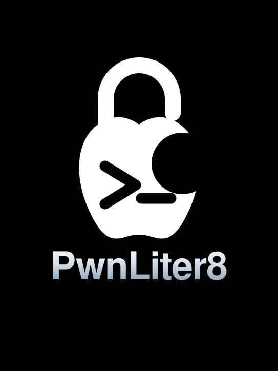

<div align="center">



# Pwnliter8

**A tethered bootrom exploit for Apple A12, S4/S5 & A13**


[LED status light](#the-led-status-light) · [Quick start](#quick-start) · [Building](#building) · [Pwnliter8ctl](#pwnliter8ctl) · [Repository layout](#repository-layout) · [Maintenance](#maintenance)

</div>

---

A12X/Z can theoretically be supported as well, but it's not implemented yet.
This is a fork of [`usbliter8`](https://github.com/20obb/usbliter8), renamed
**Pwnliter8** — the target-side banner now reports `PWND:[Pwnliter8]`.

> [!NOTE]
> The technical write-up for the underlying bug is in the
> [original blog post](https://ps.tc/pages/blog-usbliter8.html).

---

## Contents

| | Section |
|---|---|
| 🚀 | [**Quick start**](#quick-start) — hardware, flashing, exploiting |
| 💡 | [**The LED status light**](#the-led-status-light) — what every colour means |
| 🛠 | [**Building**](#building) — from source |
| 🎛 | [**Pwnliter8ctl**](#pwnliter8ctl) — demote / boot raw iBoot |
| 📁 | [**Repository layout**](#repository-layout) |
| 🔧 | [**Firmware improvements**](#firmware-improvements--refactoring) — what changed and how |
| ⚠️ | [**Maintenance**](#maintenance) — read before changing anything |

---

## Quick start

### 1 · Hardware

The exploit abuses a very low-level bug in the USB controller, which the default
Mac/PC USB stack can't normally reach. So we use a Raspberry Pi **RP2350**
microcontroller board instead.

The primary board is the [**Waveshare RP2350 USB-A**](https://www.waveshare.com/wiki/RP2350-USB-A)
with a Lightning-to-USB-A cable, and the R13 resistor *optionally*
[removed](https://qsantos.fr/2025/11/21/fixing-the-rp2350-usb-a-not-working-as-usb-host/).

Other RP2350 boards work too if you cut a Lightning cable and solder it directly
to the corresponding pins.

> [!WARNING]
> - **Do NOT use USB-C cables** — they often have a very different pinout.
> - Keep the Lightning end of the cable **relatively short**.
> - Signal pins are **GPIO12 (D+)** and **GPIO13 (D−)** by default, but that's configurable.

**Tested on:** Waveshare RP2350 USB-A

RP2040 can theoretically be used too, but it is currently **not** very stable
and the Apple A13 SoC does **not** work on it at all.

### 2 · Flash the firmware

Prebuilt **UF2** images for the boards above are in the Releases section. Flash
either via the RP2350 bootrom's mass-storage mode or with
[picotool](https://github.com/raspberrypi/picotool).

Not on a supported board? Add your own config file under `boards/` and follow
[Building](#building).

### 3 · Exploit

1. Put the device into [**DFU mode**](https://theapplewiki.com/wiki/DFU_Mode#A11_and_newer_devices_without_clickable_home_buttons_(iPhone_8_and_above,_iPad_Pro_2018_and_above,_iPad_Mini_2021,_iPad_Air_2020_and_above,_iPad_10th_generation))
   while it's connected to your Mac/PC.

   > Do **NOT** enter DFU by breaking LLB — that will not work.

2. Unplug it from the Mac/PC and plug it into your RP2350 board.

3. Watch the LED — see [The LED status light](#the-led-status-light). Or open the
   virtual COM port for the logs. The exploit typically takes **0.7 – 1.2 s**.

### 4 · Verify and use

Replug the device back into your Mac/PC. The USB serial number should now end
with the `PWND` string:

```
CPID:8020 CPRV:11 CPFM:03 SCEP:01 BDID:0E ECID:XXXXXXXXXXXXXXXX IBFL:3C SRTG:[iBoot-3865.0.0.4.7] PWND:[Pwnliter8]
```

From here you can demote production mode or boot raw iBoot — see
[Pwnliter8ctl](#pwnliter8ctl).

---

## The LED status light

The on-board LED is the primary status indicator. The RP2350 also appears as a
**virtual COM port** where exploit logs are printed, but the LED is what you
watch while plugging the target in.

### Palette at a glance

| | Colour | Hex | Role |
|---|---|---|---|
| 🟧 | **Amber** | `#FFB020` | Animation step 1 |
| 🟦 | **Electric Cyan** | `#00D5FF` | Animation step 2 → **Idle** |
| 🟩 | **Lime Green** | `#A3E635` | Animation step 3 → **Exploit running** |
| 🟪 | **Royal Purple** | `#A855F7` | Animation step 4 → **Success** |
| 🟥 | **Signal Red** | `#FF3B4F` | Animation step 5 → **Failure** |

All colours run at **50 % brightness**. Every RGB channel is scaled by the same
factor, so the hue ratios above are reproduced exactly — the colours are not
washed out or shifted.

### Power-on animation

On every power-on or reset the LED plays a colour sweep **once**, then settles
on idle. It runs entirely inside the firmware's 2-second boot window, before USB
or the exploit start.

```
  t =   0 ms   🟧  Amber
  t = 150 ms   🟦  Electric Cyan        ┐
  t = 300 ms   🟩  Lime Green           │ decorative sweep
  t = 450 ms   🟪  Royal Purple         │ runs ONCE per power-on
  t = 600 ms   🟥  Signal Red           ┘
  t = 750 ms   🟦  Electric Cyan  ← animation over, steady idle
  t =  2 s     USB starts, waits for a target
```

> [!IMPORTANT]
> **The animation is purely decorative.** The purple and red you see during the
> sweep are *not* success/failure events — they are simply two of the five
> palette colours being displayed in sequence. **Only the steady states below
> carry meaning.**

### Steady states

| | Colour | Meaning | Set when |
|---|---|---|---|
| 🟦 | **Electric Cyan** `#00D5FF` | **Idle** | Boot finished, waiting for a target |
| 🟩 | **Lime Green** `#A3E635` | **Exploit running** | A target was actually detected *and* the race has begun |
| 🟪 | **Royal Purple** `#A855F7` | **Success** | The exploit has **confirmed** success |
| 🟥 | **Signal Red** `#FF3B4F` | **Failure** | The exploit failed, or a fatal error occurred |

Every state changes **only when the existing firmware logic confirms it**:

- Merely **connecting** a device does *not* turn the LED lime — USB connection
  and device detection are not the same as "exploit started".
- **Lime** is set at the moment the race actually begins.
- **Purple** is set only on a confirmed success, never optimistically.
- **Red** is set on a genuine failure path.

> [!TIP]
> After **either** success or failure the firmware stops and waits forever.
> Power-cycle the board to retry — on-board button, `picotool load`, or just
> unplug and replug.

### Single-colour LED (Raspberry Pi Pico 2)

The Pico 2 has no RGB LED, so states are encoded as blink patterns instead:

| Pattern | Meaning |
|---|---|
| 💡 Slow blink — 200 ms period | Booting (~2 s) |
| 🌊 Breathing — fading in and out | Idle, ready to exploit |
| ⚡ Rapid blink — 100 ms period | Exploit running |
| ✅ Steady on | Success |
| ⭕ Off | Failure |

### Which LED does my board have?

| Board | LED type | Behaviour |
|---|---|---|
| **Waveshare RP2350 USB-A** | RGB · WS2812 on GP16 | Colour sweep + status colours |
| **Waveshare RP2350 Zero** | RGB · WS2812 on GP16 | Colour sweep + status colours |
| **Pimoroni TINY2350** | RGB · PWM on GP18/19/20 | Colour sweep + status colours |
| **Adafruit Feather RP2040** | RGB · WS2812 on GP16 | Colour sweep + status colours · RP2040, less reliable |
| **Raspberry Pi Pico 2** | Single colour | Blink patterns, no sweep |
| **Raspberry Pi Pico** | **Disabled** | Deliberately turned off in `boards/pico.cmake` — it made reliability worse |

---

## Building

### Pre-built firmware

Pre-built **UF2** images are available in the [`artifacts/`](artifacts/) directory:

| File | Board |
|---|---|
| `Pwnliter8.waveshare_rp2350_usb_a.uf2` | Waveshare RP2350 USB-A |
| `Pwnliter8.waveshare_rp2350_zero.uf2` | Waveshare RP2350 Zero |
| `Pwnliter8.pimoroni_tiny2350.uf2` | Pimoroni TINY2350 |
| `Pwnliter8.pico2.uf2` | Raspberry Pi Pico 2 |

Flash via RP2350 bootrom mass-storage mode or with [picotool](https://github.com/raspberrypi/picotool).

### Requirements

| Tool | Version |
|---|---|
| [Pico SDK](https://github.com/raspberrypi/pico-sdk) | **2.2.0** — commit `a1438dff1d38bd9c65dbd693f0e5db4b9ae91779` |
| [ARM GNU Toolchain](https://developer.arm.com/downloads/-/arm-gnu-toolchain-downloads) | **15.2.Rel1** |
| [picotool](https://github.com/raspberrypi/picotool) | any recent (depends on `libusb`) |
| CMake | ≥ 3.13 |

### Build one board (recommended)

```sh
cd Pwnliter8
cmake -S . -B build -DPICO_BOARD=$PICO_BOARD \
      -DPICO_SDK_PATH=$PICO_SDK_PATH -DPICO_TOOLCHAIN_PATH=$PICO_TOOLCHAIN_PATH
cmake --build build
```

`$PICO_BOARD` is one of:

| Value | Board |
|---|---|
| `waveshare_rp2350_usb_a` | Waveshare RP2350 USB-A |
| `waveshare_rp2350_zero` | Waveshare RP2350 Zero |
| `pimoroni_tiny2350` | Pimoroni TINY2350 |
| `pico2` | Raspberry Pi Pico 2 |

### Build all release boards at once

```sh
export PICO_SDK_PATH=/path/to/pico-sdk   # must be 2.2.0
./build_release.sh                       # writes artifacts/Pwnliter8.<board>.uf2
```

Use `./build_release.sh --clean` to remove old artifacts before building.

### Shellcode / payload regeneration

The pre-built payloads in `resources/*.h` are committed. To regenerate them
(e.g. after modifying shellcode sources):

```sh
# T8020/T8006 shellcode
cd shellcode/t8020_t8006
TARGET=t8020 ./make.sh
TARGET=t8006 ./make.sh

# T8030 shellcode
cd ../t8030
./make.sh

# USB request handler
cd ../usb_req_handler
TARGET=t8020 ./make.sh
TARGET=t8006 ./make.sh
TARGET=t8030 ./make.sh
```

Requires: `clang` (with arm64-apple-macos11 target), `vmacho`, `xxd`, and
`cctools` at `~/cctools/bin/arm64-apple-darwin11-ld`.

### Host-side tests

No hardware and no `pyusb` required:

```sh
python3 -m unittest discover -s tests -v
```

### CI

A [GitHub Actions workflow](.github/workflows/ci.yml) runs on every push and PR:
- Host-side tests (no hardware needed)
- Firmware builds for all four release boards

---

## Pwnliter8ctl

`Pwnliter8ctl` is a Python control tool for an already-pwned DFU device. It can
**demote** production mode or **boot raw iBoot** ("raw" meaning decrypted and
free of any container).

It depends on `pyusb`:

```sh
pip install pyusb
```

```console
$ ./tools/Pwnliter8ctl
usage: Pwnliter8ctl [-h] [--version] {boot,demote} ...

Pwnliter8 control tool — boot raw iBoot or demote production mode

options:
  -h, --help     show this help message and exit
  --version        show program's version number and exit

subcommands:
  {boot,demote}
    boot         boot raw iBoot
    demote       demote production mode

Love is Control
```

```sh
./tools/Pwnliter8ctl demote
./tools/Pwnliter8ctl boot /path/to/iboot.raw
```

---

## Repository layout

| Path | What it is |
|---|---|
| `src/` | Firmware source code |
| `src/main.c` | Entry point — clock setup, auto-retry loop / debug shell |
| `src/exploit.c` | Exploit entry point + high-level dispatch |
| `src/exploit.h` | Shared declarations (structs, macros, functions) |
| `src/exploit_identify.c` | Device identification & CPID extraction |
| `src/exploit_transfer.c` | Transfer utilities (SET32/64, pb_data, crazy_transfer) |
| `src/exploit_t8020_t8006.c` | T8020/T8006 exploit path |
| `src/exploit_t8030.c` | T8030 exploit path |
| `src/usb.c`, `src/bus.c` | USB plumbing and bus management |
| `src/led.c` | Status LED — colour palette, power-on animation, state machine |
| `pio_usb/` | **Vendored** [Pico-PIO-USB](https://github.com/sekigon-gonnoc/Pico-PIO-USB) — frozen, see [`VENDORED.md`](VENDORED.md) |
| `shellcode/` | Target-side payload sources |
| `shellcode/usb_req_handler/` | Target-side USB request handler |
| `shellcode/t8030/`, `shellcode/t8020_t8006/` | Target-side shellcode sources |
| `resources/*.h` | Generated payload headers consumed by the firmware |
| `boards/` | Per-board pin & LED configuration |
| `tools/Pwnliter8ctl` | Host-side Python control tool (`pyusb`) |
| `tests/` | Host-side unit tests |
| [`Docs/MAINTENANCE.md`](Docs/MAINTENANCE.md) | **Read before changing anything** |
| [`Docs/VENDORED.md`](Docs/VENDORED.md) | Vendored USB library — fork point and known divergence |
| [`CHANGES.md`](CHANGES.md) | Detailed changelog of all improvements |

---

## Firmware Improvements & Refactoring

A comprehensive stability and maintainability pass. **No exploit logic was changed** — the exploit flow, timing constants, delays, buffer sizes, and assembly instructions are identical.

### Code Organization

The monolithic `exploit.c` (842 lines) was split into focused modules:

| File | Responsibility |
|---|---|
| `src/exploit.c` | Entry point + high-level dispatch (~100 lines) |
| `src/exploit.h` | Shared declarations (structs, macros, functions) |
| `src/exploit_identify.c` | Device identification & CPID extraction |
| `src/exploit_transfer.c` | Transfer utilities (SET32/64, pb_data, crazy_transfer) |
| `src/exploit_t8020_t8006.c` | T8020/T8006 exploit path |
| `src/exploit_t8030.c` | T8030 exploit path |

### Project Structure

Firmware sources moved to `src/`, shellcode sources to `shellcode/`, and the host tool to `tools/`:

```
src/          — Firmware C sources (now split by responsibility)
shellcode/    — All target-side payload sources
resources/    — Generated payload headers (unchanged)
boards/       — Per-board pin & LED configuration (unchanged)
pio_usb/      — Vendored PIO USB library (unchanged)
tests/        — Host-side unit tests
tools/        — Host-side Python tool
```

### Build System

- **Prerequisite checks** — `build_release.sh` validates `PICO_SDK_PATH`, `cmake`, and `arm-none-eabi-gcc` before building
- **Per-board build directories** — `build/<board>/` instead of wiping `build/` each iteration
- **Artifact preservation** — failed builds no longer destroy previously built release UF2s
- **`--clean` flag** — optional cleanup of old artifacts
- **Actionable error messages** — clear diagnostics instead of cryptic failures
- **Shellcode scripts** — all `make.sh` scripts validate `clang`, `vmacho`, `xxd`, and `TARGET`

### Host Tool (`Pwnliter8ctl`)

- Added `--version` flag
- Added `idVendor=0x05AC` check in addition to `idProduct`
- Improved error messages with specific details
- Named constants for VID/PID

### CI

- Added [`.github/workflows/ci.yml`](.github/workflows/ci.yml) — automated host-side tests + firmware builds for all four release boards

### Verification

| Check | Result |
|---|---|
| `python3 -m unittest discover -s tests -v` | **9/9 pass** |
| `./build_release.sh` (all 4 boards) | **4/4 pass**, zero compiler warnings |
| Exploit logic / timing / constants | **Unchanged** |
| On-hardware validation | **Not performed** |

---

## Maintenance

> [!WARNING]
> RP2350 executes this firmware from external QSPI flash through a small
> instruction cache, and cache evictions shift instruction timing. **Seemingly
> unrelated code changes can reduce exploit reliability.** Read
> [`Docs/MAINTENANCE.md`](Docs/MAINTENANCE.md) before touching a single line — it lists the
> strictly protected files, the load-bearing oddities that look like bugs but
> aren't, and the pre/post-change checklists.

The short version:

- ⏱️ `sleep_ms(2000)` in `main.c` and `sleep_ms(60)` in `exploit.c` are
  **load-bearing**. Do not remove them as dead delays.
- 💡 **Blinking the LED during the exploit breaks reliability** — which is why
  LED activity in timing-sensitive paths is deliberately minimal.
- 📦 `pio_usb/` is vendored and frozen. See [`Docs/VENDORED.md`](Docs/VENDORED.md).
- ⚙️ RP2040 builds are inherently less reliable than RP2350. That's a property
  of the hardware timing, not a code defect to patch.

---

<div align="center">

**Love is Control**

</div>
